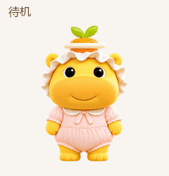

# 噜妹 · 精修版 Codex 宠物

白色荷叶帽、粉色连体衣的噜妹，精修了五官、服装轮廓以及七组动画。

## 文件说明

- `spritesheet.png`：已安装版本使用的透明动画精灵表（1536 × 2288，v2）。
- `pet.json`：宠物名称和精灵表配置。
- `preview.gif`：七组精修动作的预览。
- `portrait.png`：精修后的高分辨率角色形象。

眨眼、挥手、跳跃、失落、等待、工作和检查动作经过精修；走动和视线方向保留自原有版本，因此切换时可能有轻微画风差异。桌面显示时，每一帧的尺寸仍受应用格式限制。

## 来源与使用

本作品基于 [legeling 的噜妹社区宠物](https://github.com/legeling/awesome-codex-pet/tree/main/pets/lumei--legeling)进行精修，保留了原版的部分动作；精修形象及动作使用 OpenAI 图像生成工具制作。

原项目对该素材的说明是**仅限非商业用途，禁止商业使用**；角色相关权利属于各自权利人。请遵守原素材的使用条件。

